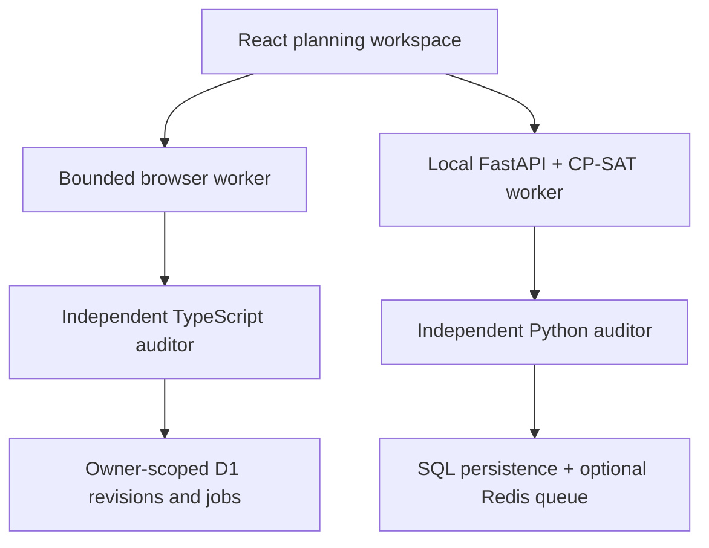

# Architecture and assurance boundaries

The same explicit weekly-template problem contract is used by two runtime paths.

The private hosted frontend runs on the supported Worker platform. It does **not** run Python or mislabel the browser algorithm as CP-SAT. Browser search is finite-domain depth-first branch-and-bound with a node/time budget and a100-event limit. Its feasible assignments are independently audited in the browser and again server-side before a saved result is accepted. A client-reported solver status is not a cryptographic attestation of optimality.

The local application uses the same React workspace, built independently with Vite and served by FastAPI. CP-SAT runs in isolated processes in local development; the provided Compose configuration uses PostgreSQL, Redis and a separate queue worker. The API owns jobs, cancellation, bounded retained events, SSE, immutable problem snapshots and independently audited exports. Native hosted identity uses account-scoped D1 records; local authenticated mode uses Argon2id password hashing and opaque expiring session cookies.

## Precisely what is checked

The normalized list of session events is the authoritative weekly contact requirement. H1 means every declared event occurs exactly once. Credits are metadata with an explicit separation from contact duration; the application does not infer a program's curriculum requirements from a credit number. H2–H11 cover resources, selected attendees, synchronized baskets, continuous blocks, capacity, equipment/qualification, availability, workload and theory spread. Optional travel and lock rules are H12/H13 and are reported as not applicable when disabled.

Checkers reconstruct occupancy from problem data and raw assignments. They do not import solver placement-building code. Shared schemas are permitted; shared solver results are not treated as evidence. Mutation tests and tiny independent counting cases provide evidence about the checkers/model, not a universal proof of software correctness.

## Deliberate supported scope

- Travel buffers are checked within each day; validation requires enough free time at teaching-day boundaries for any enabled travel buffer.
- Student pathway groups must be disjoint sets with identical declared selections; hidden real-world overlaps cannot be inferred from anonymous group IDs.
- One repeated weekly template, one term of at most 366 days, equal-length teaching periods, Monday-first day lists, explicit breaks, and holiday exclusions in dated calendar exports.
- One selected teacher per meeting, chosen from eligible qualified faculty. Co-teaching and alternate-week schedules are rejected as unknown fields instead of being silently ignored.
- Synchronized alternative sessions have equal duration. Actual group selections, rather than the entire parent cohort, determine attendance conflicts.
- Repair changes availability/resource constraints and placements within the same calendar reference. Calendar changes require a fresh solve. A closure selected by weekday/period applies to the weekly template; it is not silently claimed to be a one-off dated exception.
- Program profiles are configuration examples requiring institution-specific policy review, not certified UGC/NCTE rules.
- The transit adapter preserves an explicitly supplied common resource-allocation schema. It is not a complete GTFS, vehicle-continuity or crew-duty optimizer.

## Canonical data and integrity

This implementation uses its own documented canonical JSON contract: recursively sorted object keys, UTF-8, no insignificant whitespace, finite JSON numbers, and integral floats serialized as integers in Python. Schedule arrays are sorted by canonical assignment text before hashing. This is tested for the supported schema across Python and TypeScript; it is not a general claim of RFC8785 conformance for arbitrary JSON.

SHA-256 input is `TimetableGenie/<domain>/v1` followed by a newline and the canonical payload. Domains are `problem`, `schedule`, and `audit`. Audit payload identity excludes its own digest, issuance timestamp and explanatory signature-status string. Problem and schedule digests match across languages; audit digests can differ because checker versions and diagnostic wording are intentionally distinct. Integrity checking needs a trusted expected digest. Certificates are unsigned and say so. No signing keys, metadata anonymization, zero-knowledge proof, or crypto-based feasibility proof is invented.

## Optimization and evidence

Soft quality minimizes occupied-period seat slack minus preferred-period reward, plus resource idle periods, consecutive occupied-period building transitions and optional faculty workload spread. Travel feasibility is separately hard when enabled. Repair minimizes changed full assignment tuples before ordinary quality; a derived dominance coefficient is used, and valid baseline placements are hints rather than forced locks. `objective` is quality; `search_objective` and `best_bound` refer to the encoded objective, including repair priority where applicable.

The source registry, raw pilot results, validation log, and implementation report state observed coverage and limits. They do not claim competitive superiority or publication acceptance.
